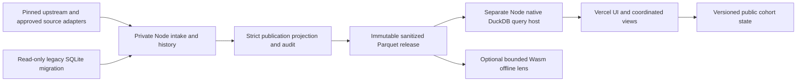

# V2.5: Node.js data virtualization and visual analysis

Design researched 2026-10-16. The user subsequently authorized V2.5 implementation and separate
deployment, including admin and visual identity. V2 stays live independently; V3 employee/profile
integration remains excluded. See the [execution addendum](V2_5_EXECUTION_AND_ADMIN.md) for implementation
decisions that supersede proposal-only gates below. No paid subscription or provider purchase is authorized.

## Recommendation and scope

Build a TypeScript/Node.js application stack with a **read-only native DuckDB query service**, a Vercel
frontend, and an isolated Node ingestion/materialization process. The browser requests bounded results
for coordinated analytical views, rather than receiving every detailed posting before interaction.
Keep a browser DuckDB-Wasm route as an explicitly bounded offline/static alternative to benchmark.
The primary architecture is concrete; its operating cost and deployment host require review.

“Fully Node.js” means ingestion, migration, normalization, publication and service orchestration have no
Python runtime dependency. Browser code remains TypeScript compiled to JavaScript; Node does not run
inside the browser. SQL, native DuckDB binaries and optional Wasm remain deliberate dependencies.

The opportunity is reduced browser data ownership, memory and transfer of unneeded fields, plus one
shared analytical contract. It is not evidence that V2 is universally slow. Its combined population is
86,190 distinct postings; the current full posting payload is 140,925,161 bytes of JSON, approximately
7,041,786 bytes under offline gzip level 6. Raw JSON size is not network transfer size. Warm filtering
already has encouraging V2 measurements; compare them on identical devices before claiming improvement.
See the [implemented pipeline](V2_DATA_PIPELINE.md) for measured scope and caveats.

**Data virtualization** here is a stable logical model over versioned sanitized stores: charts ask for
named measures, eligible populations and contributor sets without knowing physical files or joins.
**Visualization** is how those results appear and respond to interaction. The proposal changes both.
It still performs deliberate snapshot materialization and publication; it does not promise zero ETL,
zero copies, live federation across arbitrary job boards, or improved market representativeness.

## Comparison to V2

| Decision | V2 being built | Proposed V2.5 experiment |
|---|---|---|
| Pipeline | Existing Python intake/normalization plus TypeScript UI | Node/TypeScript owns intake, history, publication, backup and queries |
| Browser data | Validated detailed JSON for the active source mode in a worker | Aggregates and requested public detail pages; full rows stay on the query host |
| Logical access | In-memory posting objects and shared analysis functions | Versioned semantic views over columnar facts/bridges with a bounded query compiler |
| Presentation | Four workspaces sharing selections | A linked research canvas with context, comparison and evidence alongside the selected view |
| Hosting | Static frontend, no query-service uptime requirement | Frontend plus read-only query host, with network, concurrency and operating-cost tradeoffs |
| Adoption | Existing implementation remains the baseline | Retained only if the same-data comparison demonstrates worthwhile benefits |

The virtualization layer owns a source catalog, logical views, query compilation, result caching and
contributor identity. Physical optimization may use pre-aggregates for common occupation/level/source
queries, but those must reconcile to the fact tables and carry the same release/method version. Detail
projection, dimension filters and aggregation happen before results cross the service boundary. Do not
add a distributed federation platform merely for an 86k-row snapshot; begin with one immutable release
and one query service, then measure the need for further components.

## Researched building blocks and decisions

| Component | Proposed use and limits |
|---|---|
| Native DuckDB Node Neo | Ingestion/materialization and primary query service; pin compatible Node, package and native platform versions. |
| DuckDB-Wasm | Optional browser worker engine for a bounded public snapshot/offline lens, using the same query semantics. |
| Parquet | Immutable compressed analytical facts, bridges and detail partitions; physical row groups and sorting chosen by actual query benchmarks. |
| Arrow | Typed columnar query-result interchange where its measured benefit beats small JSON responses. |
| Mosaic | Coordinated selections, query scheduling and linked views through a controlled connector. |
| Arquero | Optional small-result transformation; not a second authoritative metric engine or a reason to reload all records. |
| Shared contracts | TypeScript/Zod for request/response definitions, generated JSON Schema plus independent validation at publication and query boundaries. |

DuckDB's current Node API is `@duckdb/node-api`, backed by native bindings. The official documentation
also lists Arrow APIs among incomplete features, so this proposal does not assume a finished zero-copy
Node-to-Arrow export. Start bounded results as JSON; evaluate an explicit Arrow encoding adapter before
enabling binary responses. [DuckDB Node Neo documentation](https://duckdb.org/docs/current/clients/node_neo/overview).
Require a supported prebuilt native binding in CI and deployment. Unexpected source-build or
`node-gyp` fallback fails the compatibility gate instead of silently introducing a Python build toolchain.

Parquet is a column-oriented storage format with compression/encoding support; Arrow specifies a
columnar memory/interchange representation. They serve different roles. DuckDB supports Parquet column
projection and filter pushdown, with row-group skipping dependent on statistics and layout. “Columnar”
alone does not guarantee a particular query reads fewer bytes.
[Parquet overview](https://parquet.apache.org/docs/overview/),
[Arrow columnar format](https://arrow.apache.org/docs/format/Columnar.html),
[DuckDB Parquet reading](https://duckdb.org/docs/current/data/parquet/overview).

Mosaic clients submit data needs to a coordinator; selections connect views and queries. Use that
interaction model through our semantic connector, not unrestricted browser-generated SQL sent to the
service. Its packaged `duckdb-server` is Python-based and therefore excluded. An application-specific
Node adapter is required for the server route; compatibility is a proof-of-concept gate.
[Mosaic architecture](https://idl.uw.edu/mosaic/what-is-mosaic/),
[Mosaic server documentation](https://idl.uw.edu/mosaic/server/).

Arquero provides JavaScript column-oriented transformations and accepts Arrow columns. Restrict it to
bounded presentation work such as reshaping a returned comparison matrix; eligibility, denominators
and cohort membership stay in the semantic engine. This avoids subtly different metric definitions
across charts. [Arquero documentation](https://idl.uw.edu/arquero/).

## Reference architecture and deployment decision



**ADR-01: primary execution sits on a separate long-lived Node host.** It loads verified sanitized
release data once, maintains bounded connections and result caches, and exposes small typed queries.
Vercel serves the frontend; a same-origin proxy is optional and must not become a bulk-data relay.
The Node host/provider, region, storage and spending cap are unresolved review decisions. Nothing is
provisioned. An outage shows a clear unavailable state or a separately disclosed cached snapshot;
it must not silently switch dataset or source mode.

Vercel supports Node functions, but function bundle, memory, duration and request/response limits must
be checked against the selected plan. Current documentation states a 4.5 MB function payload ceiling
and describes larger-function options as beta. This motivates bounded responses and external bulk
artifacts, not a claim native DuckDB cannot run there. A function-only prototype remains a benchmark
candidate; it is not the primary persistent query-host assumption.
[Vercel Node runtime](https://vercel.com/docs/functions/runtimes/node-js),
[Vercel function limits](https://vercel.com/docs/functions/limitations).

| Decision criterion | Primary Node native service | Optional static browser Wasm |
|---|---|---|
| Browser data/memory | Aggregates and requested details only | Engine plus required public columns/partitions remain client-owned |
| Deployment | Vercel UI plus another host and operating budget | Vercel/static assets; no query-service uptime dependency |
| Interaction latency | Includes network and service queue | Local after relevant data arrives |
| Public snapshot offline use | Requires a deliberate bounded download | Natural optional capability after verified caching |
| Isolation | Process mounts sanitized stores only | All shipped bytes must be public |
| Main uncertainty | Hosting cost, concurrency and regional latency | Startup, memory, Wasm loading and actual range behavior |

DuckDB-Wasm executes in a browser worker and returns Arrow results. Its documentation explicitly warns
that partial fetching depends on the HTTP implementation: the JavaScript path can request ranges,
while the built-in httpfs path may download the full file. An offline/static prototype must inspect
actual requests, CORS and hosting range support; it cannot label a full-file fetch “lazy.”
[Wasm architecture and HTTP caveat](https://duckdb.org/docs/current/clients/wasm/overview),
[Wasm file registration](https://duckdb.org/docs/current/clients/wasm/data_ingestion).

For that alternative, initially fetch small content-hashed Parquet partitions completely, verify their
bytes, then register buffers. Whole-file SHA-256 cannot authenticate an arbitrary range without the
remaining bytes. True ranged integrity would need a separately designed chunk/hash scheme; do not
quietly discard V2's integrity boundary for an optimization. Measure the partition strategy first.

## Node ingestion, history and storage

Create proposed packages `contracts`, `ingest`, `semantic`, `query-service`, and `web`. Prefer ESM
TypeScript across owned code. A CommonJS consumer can receive a tested compatibility export if needed;
there is no requirement to build two independent contract implementations.

The migration inventory covers every existing Python responsibility, with an explicit supported-adapter
panel rather than claiming every configured employer suddenly works:

| Existing responsibility | Proposed Node-owned replacement |
|---|---|
| Collection/adapters | Approved source adapters, robots/refusal decisions, pagination, completeness and retries |
| Normalization | Pay, skill/license and SOC rules with fixed parity fixtures and method versions |
| SQLite history/status | Read-only migration, posting versions, observations and closure semantics |
| Upstream intake/publication | Pinned checks, supplement audit, rejects, strict projection and immutable export |
| CSV export | Exact contributor-backed export, safe cells and documented units |
| Private backup | Consistent private snapshot/archive, integrity manifest, private-repository verification and restore test |
| Scheduling/verification | Explicit Node commands and test runners; no scheduled Python subprocesses |

The private backup adapter may use GitHub's release-assets API through Node, keeping its authentication
only in the isolated ingestion/backup environment. Upload remains blocked unless repository privacy is
verified, preserving the existing safeguard; the public query host gets no backup token.
[GitHub release-assets API](https://docs.github.com/en/rest/releases/assets).

The initial materialization consumes the same pinned upstream CSVs and audited optional HTML as V2.
It preserves all currency safeguards: `$` alone does not prove USD, typed currency recovery requires
native-bound/unit agreement, and annual values are independently validated. Reading the already
sanitized V2 release is a useful parity fixture, not a substitute for Node intake ownership.

Use an isolated, one-time read-only Node migration of the existing SQLite `postings`, versions,
observations and snapshots. Preserve IDs, hashes, dates, completeness and refusal/error history; verify
source-file hashes before/after and table/count checks. Node's SQLite interface documents a read-only
opening option; pin the selected runtime/API and test its behavior rather than assuming compatibility
with whatever Node is installed. [Node 24 SQLite documentation](https://nodejs.org/docs/latest-v24.x/api/sqlite.html).

Private raw/evidence/history storage stays separate from a sanitized publication store. Future adapters
return `{records, observedAt, cursor, inventoryStatus, reportedTotal, exhausted, refusalReason}` with
source-specific parsers, rate limits, retries and resumable run IDs. A failed/partial run never proves
absence. Preserve the current complete-inventory closure rules; upstream-reported closure remains a
different statement from local observation. No live refresh is implied by a new release format.

Official ATS documentation is a source-specific starting point: Greenhouse documents public GET job
board endpoints; Lever documents site-scoped published listings and pagination. This does not grant
generic permission to disregard site restrictions or publish descriptions. Retain the project's robots,
terms/refusal decisions and assess each configured source independently.
[Greenhouse Job Board API](https://docs.greenhouse.io/job-board.html),
[Lever Postings API](https://github.com/lever/postings-api).

Use asynchronous I/O with bounded source concurrency. A small persistent `worker_threads` pool can
handle CPU-heavy normalization; it should not create a worker per network request. Native query-engine
parallelism also needs a shared CPU/memory budget rather than multiplying pools without measurement.
[Node worker thread guidance](https://nodejs.org/api/worker_threads.html).

Publish immutable releases after validation, not during collection. Record source hashes/as-of,
normalizer/merge/schema versions, rejects, overlap/conflicts and release lineage. Repeated equivalent
inputs must yield the same semantic release identity; exact Parquet bytes have separate hashes.
Parquet writer metadata or layout changes can alter physical bytes without changing posting semantics.
Refresh scheduling, object storage and retention duration remain configuration proposals, not active jobs.

## Logical model and exact analytical units

Publish narrow relations with explicit keys:

| Relation | Grain and purpose |
|---|---|
| `posting_variant` | One row per release, source mode and canonical posting ID; scalar facets, dates, availability and pay eligibility |
| `posting_skill` | One unique posting/skill pair within that mode; mention basis and description-coverage basis |
| `posting_location` | One posting/location association, precision and primary flag |
| `posting_provenance` | Field/group source references, as-of and conflict indicators |
| `posting_detail` | Public title, URL and expanded safe metadata; fetched only for inspected/page rows |
| Dimensions | Stable company, occupation, skill, license and source IDs/labels |

Mode-specific variants retain source semantics. Combined, upstream and local must reproduce V2's
86,190 / 86,144 / 92 distinct IDs, with 46 overlaps in the fixed benchmark. Normalize repeated strings
and separate detail payloads; initially avoid clever delta reconstruction that obscures provenance.

The default unit is **distinct postings**, never bridge rows. Location filtering uses existence tests;
a multi-location posting counts once. A skill co-mention numerator counts distinct eligible postings
containing both IDs, not duplicated Cartesian joins. Company coverage counts distinct company IDs.
No posting disappearance is a hire, and no posting count estimates an employed or available workforce.

Define eligibility beside every measure. USD salary summaries require validated USD ranges and state
whether the statistic uses low, high or midpoint values; they describe advertised ranges, not salaries
actually paid. Skill mention share and analyzed-description share remain separate measures. Unknown
upstream text coverage is not a negative skill observation. Unknown degrees, currency, location,
availability and dates remain explicit buckets or excluded populations with disclosed counts.

## Virtual query contract and execution

Define one versioned request model shared by UI, Node service and optional Wasm compiler:

```ts
type QuerySpec = {
  protocolVersion: '2.5'; datasetVersion: string;
  questionId: QuestionId;               // named analytical intent from the metric registry
  sourceMode: 'combined' | 'upstream' | 'local';
  filter: PredicateTree;                 // enumerated fields/operators, bounded depth
  cohort: CohortReference | null;
  view: 'overview' | 'compare' | 'skills' | 'records' | 'evidence';
  measures: MeasureId[]; groupBy: DimensionId[];
  page: { after: string | null; limit: number };
  requestId: string;
};
```

Question IDs initially cover inventory distribution, cohort comparison, skill mentions, advertised pay
and source quality. One resolver produces QuerySpec for every chart, table and CSV request. Predicate
leaves allow only registered dimension membership, numeric bounds, explicit-null tests and bounded
text search; `and`/`or` nodes have a proposed depth limit of four and 16 children per node. Enumerate
field/operator combinations in the schema rather than accepting arbitrary expressions. Many-location
and many-skill filters compile to existence predicates, preventing join fanout in counts and exports.

The response includes release/method versions, query hash, request ID, matched distinct count,
eligible/unknown counts, data, contributor reference, pagination and completeness. Begin with a
100-row record page and bounded category/matrix results; propose a 2 MB response budget and 5-second
interactive deadline. These are review targets, not measured capabilities. Bulk exports use a separate
bounded streaming/artifact flow with complete contributor reconciliation.

A contributor reference hashes the sorted distinct IDs together with source mode, dataset and metric
version; all panels and CSV must resolve that same identity. Dates preserve date-only versus timestamp
precision. Wire counts are validated safe integers; larger integers use schema-declared decimal strings.
Money uses an explicit decimal representation/unit rather than silently narrowing native DECIMAL or
BigInt values into floating-point JSON numbers. Unknowns remain null, never nonfinite JSON values.

Generate JSON Schema from strict Zod objects and infer TypeScript types from the same definitions.
Restrict wire schemas to representable data; avoid transformations/coercions that create divergent
input/output contracts. Zod supports JSON Schema generation with explicit draft targets; select one
and test generated schemas independently. [Zod JSON Schema documentation](https://zod.dev/json-schema).

The compiler resolves named measures and dimensions into fixed SQL templates with bound values.
Clients cannot supply SQL, file paths, URLs, functions, joins or private connection names. Cache keys
include dataset, mode, metric version, normalized predicate, grouping and cohort identity. Concurrent
requests share bounded queues; newer interactions cancel or supersede stale work. A late response may
not overwrite a newer selection. Pin A/B cohorts as immutable ID sets plus dataset/mode/method versions;
cross-version reuse requires an explicit migration report, not recomputed membership.

The public service physically mounts **only sanitized stores**, lacks collection credentials, and has
no network route or connection to private evidence. Load an approved release, verify its hashes, open
it read-only, disable unnecessary external access/extensions, and enforce OS/process resource limits.
DuckDB's own guidance treats untrusted SQL as executable code; parameterization alone does not make
arbitrary SQL or client-chosen identifiers safe. [DuckDB security model](https://duckdb.org/docs/current/operations_manual/securing_duckdb/overview).
Interactive query pushdown reads an activated release; no keystroke calls an employer API or triggers
collection. Refresh and analytical traffic use separate queues, credentials and deployment boundaries.

## Demand-focused interaction sketch

The [research-canvas wireframe](v2-5-research-canvas.svg) is a design-only companion to this layout.

```text
[Release/as-of] [Source mode] [Coverage] [Pin A] [Pin B] [Share]
[Role / employer / place / skill filter chips] [Clear selection]
| Occupation × employer demand matrix | Selected cohort vs baseline |
| Counts and unknown lane              | Pay eligibility and ranges |
| Skill co-mention matrix              | Evidence / source conflicts |
[Virtual record table: 100-row pages, inspect, exact export]
```

The first screen answers “where are the postings in this observed inventory?” using aggregated cells
and explicit coverage. Selecting a cell updates aligned counts, comparison and record pages through
one QuerySpec. A separate hover preview never commits a filter. Keyboard/touch actions offer the same
selection controls. Mobile stacks panels with a persistent selected-count and source badge.

Pin a cohort, refine a second, then show both counts, denominators and overlap before ranking differences.
Skill matrices expose supporting posting counts and an evidence link; focused networks are optional
when co-mention support passes a declared threshold. Geography appears only at known precision, and
time charts remain gated by genuine repeated observations. Query/viewport adaptation limits rendered
marks without sampling away analytical contributors. Each view offers an accessible table and concise
explanation of what its measure can support. Three-dimensional decoration adds no required analysis.

## Fair benchmark and review gates

Use the identical V2 release
`9bd992ecffd1bb6fad5a0715ca8c38a75b1bb4416df342c49abbb02a38b8de28`, all 86,190 combined records,
the same fields, pay eligibility, unknown handling, source modes, filter sequence and export requirements.
Freeze a representative QuerySpec workload before tuning. Test V2 JSON/worker, primary Node service,
and optional Wasm/Parquet on the same named desktop/mobile devices and network profiles. Report server
hardware, region, concurrent users, cold/warm caches, engine startup and transfer compression separately.

Measure first useful/fully interactive view, p50/p95 committed filter response, queue/server/network/render
time, browser peak memory, bytes per initial/changed query, Node RSS/CPU, failed/canceled requests,
record-page latency and exact export time. Verify complete ID sets, aggregates and contributor hashes;
use tolerances only for documented numeric representation differences. Include repeated source-mode
switches, empty cohorts, many-location/skill joins and unknown currency. A separate labeled 100k/1m
synthetic fixture tests scaling, not market coverage. No V2.5 speed or compression result exists yet.

Proposed engineering targets for review, to freeze after matching baseline captures and before tuning:

| Target | Proposed acceptance |
|---|---|
| Browser data ownership | Zero full posting-table downloads for the default server-backed workspace; fetch only aggregates and requested pages |
| Initial analytical payload | At most 300 KiB compressed for default aggregates/catalog, measured separately from application JS and inspected record pages |
| Browser memory | At least 50% less peak analytical memory than V2 on the same task/device; measure worker memory as well as the main thread |
| Warm interaction | End-to-end committed-filter p95 at most 300 ms on the declared desktop/network profile; report cold requests separately |
| Page detail | p95 at most 500 ms for a 100-record public page on that profile, with a stable ID tie-breaker |
| Full readiness | At most 3 seconds on the declared desktop profile; separately report mobile, cold service and failure cases |
| Concurrency | Measure queues and cancellation at 1, 5 and 10 concurrent users before proposing a capacity/SLA |
| Accuracy | Exact cohort membership/count/overlap and source semantics; documented decimal tolerances only for appropriate numeric summaries |

These are proposed targets, not V2.5 measurements or already agreed service guarantees. Avoid meeting
payload limits by silently dropping categories, contributors or unknowns. A capped display reports the
full analytical total and an explicit other/remaining-category group. Review latency and cost together:
a new service that cuts browser memory but adds excessive delay or operating effort may not be worthwhile.

| Phase | Deliverable | Acceptance before continuing |
|---|---|---|
| R0 — review | Confirm primary host model, spending boundary, data units and UI sketch | User approves this design direction; no purchases or deployment implied |
| R1 — contracts/parity | Shared schemas, metric registry, Node read-only migration and frozen fixtures | All mode IDs, history/closure tests, provenance and eligible counts match V2 |
| R2 — materialization | Node intake, publication projection, Parquet facts/bridges/details and manifest | Deterministic semantic identity, byte checks, rejects and private sentinels pass |
| R3 — semantic service | Compiled QuerySpec, bounded queue/cache, contributors and pagination | No arbitrary SQL/files/URLs; isolated sanitized mount; cancellation/version tests |
| R4 — coordinated views | Mosaic adapter proof, demand matrix, comparisons, evidence and record pages | All panels/export share contributor sets; keyboard/mobile tasks pass |
| R5 — head-to-head | Fixed-data native/Wasm/V2 benchmark and cost estimate | Clear browser-memory/transfer benefit; no unexplained latency/accuracy regression |
| R6 — release review | Proposed deployment/retention/rollback and operational budget | Separate user approval of concrete host/cost/release evidence |

Set quantitative improvement thresholds after baseline captures and before R5 tuning. If the added
service fails that agreed value test, retain V2 and publish the experiment results. This document is
the decision artifact for that experiment, not approval to replace the working application.
