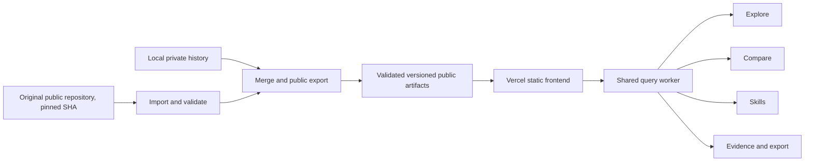

# JobMarket Lens V2 — executable design specification

Status: implementation-ready proposal. Updated 2026-10-16.
Primary deployment: **Vercel**. Initial data: **original public upstream snapshot plus local evidence**.
This document specifies implementation; the frontend, importer and deployment described here are not yet built.

This specification supersedes the 92-row-only and GitHub-Pages-first implementation assumptions in
[V2 research](V2_RESEARCH_AND_DESIGN.md). The [workspace concept](v2-workspace-concept.png) remains the visual
reference; its 92 points illustrate categorical placement, not the eventual dataset size.
Execution order and acceptance criteria are in [V2 implementation backlog](V2_IMPLEMENTATION_BACKLOG.md).

Employee/profile APIs and demand–workforce analysis are reserved for [V3](V3_DESIGN_AND_API_RESEARCH.md); they are not V2 scope.

## 1. Product outcome and release boundary

Replace the chart-heavy page with a coordinated application: **Explore / Compare / Skills / Evidence**.
A person should find a relevant set of postings, compare it with another set, and understand the evidence
and missingness behind the result. Default to guided exploration with an analyst control layer.

Deliver one coherent V2 application. Internal work packages are implementation dependencies, not a
sequence of small patches to the live V1 page. Preserve V1 at its existing GitHub Pages URL as the baseline.

Required in the first V2 release:

- A real imported upstream dataset substantially larger than 92, combined with local records through
  deterministic identity and provenance rules.
- Shared selections, explicit unknowns, A/B comparisons, a skill matrix and focused graph, record-level
  drill-down, a public evidence drawer, CSV export, reproducible links, and mobile/keyboard alternatives.
- A new React/TypeScript interface, validated analysis functions, publication checks and Vercel previews.
- Sparse-pay handling and trend-readiness explanations, rather than unsupported market conclusions.

Optional, gated lenses: skill-similarity projection, geographic map and temporal comparisons. Their
fallbacks are part of the core release. Missing data does not block the whole application.

Outside this release: 3D Gaussian Splatting; default 3D scenes; inferred hiring probabilities; actual
career-movement predictions; demographic inference; public access to private descriptions; LLM-generated
statistics; new paid data subscriptions; and long-running collection inside a Vercel request.

## 2. Verified data baseline

### 2.1 Original public repository

Authoritative audited snapshot: commit
[`7e415fe62d0597e9c6c806bf813b30f8e8c88c98`](https://github.com/yimizhao2015/jobmarket-lens/commit/7e415fe62d0597e9c6c806bf813b30f8e8c88c98),
committed 2026-10-16T12:53:22Z. Counts below describe that snapshot, not an automatically current feed.

| Item | Audited value |
|---|---:|
| Public `data/Job postings.csv` | 86,144 rows; 37,993,867 bytes |
| Employers represented | 310 |
| Reported open / closed | 82,805 / 3,339 |
| Duplicate posting IDs within CSV | 0 |
| Rows with pay marked absent | 56,347 |
| Upstream normalized posting-date span | 2026-10-01 to 2026-10-16 |
| Public `data/data source.csv` | 499 company rows |

These public files do **not** provide full descriptions or reliable local observation history. They
contain upstream-normalized values and statuses. The upstream pipeline's caps, extraction rules and date
normalization still apply. Importing more records improves exploration breadth, not representativeness.

Pinned source URLs and checksums are recorded in [source audit](V2_UPSTREAM_SOURCE_AUDIT.json).

### 2.2 Local collection

The current private/local collection has 92 posting IDs from seven employers, one observation date,
four operationally complete inventories and three partial samples. All 92 have private descriptions;
only three salary records pass current USD aggregate eligibility. Country is unknown in 47 local rows.

Exact posting-ID overlap with the audited upstream CSV: **46**. Candidate combined unique count:
**86,190**. This is set arithmetic before implementing the merge; it is not a claim that a combined
public release exists. Report actual import, rejection and merge counts in the release manifest.

## 3. Acquisition and enrichment pipeline

### 3.1 Source priorities

1. **Public upstream posting list and company coverage** seed the broad V2 inventory.
2. **Local observed postings and private descriptions** provide independently collected evidence.
3. **Fresh official-career-site collection** enriches selected records over time, including records
   absent from the upstream date window. Retain the existing refusal/robots behavior.
4. **O*NET occupation/skill references** and **BLS OEWS wage benchmarks** are subsequent evaluated
   enrichment datasets; a failed optional download cannot prevent loading the main inventory.

Never depend on the author's private repo. Vercel builds must not fetch private history. Public upstream
refreshes happen in an explicit ingestion step, not as every visitor opens the page or every preview builds.

### 3.2 Import procedure

Implement `scripts/import_upstream.py` with `--commit SHA`, optional `--refresh-latest`, `--dry-run` and
an output/report directory outside public deployment directories. Default to an explicitly supplied or
previously pinned commit. A latest refresh resolves a commit once, then downloads every file at that SHA.

Required intake: `data/Job postings.csv` and `data/data source.csv`. Validate headers, encoding, typed
values, IDs and source URLs; write rejects with reasons privately. Record URL, SHA-256, retrieved timestamp,
commit, schema version and row counts. Preserve the unmodified public download in an ignored intake
archive; never overwrite local evidence tables with this CSV.

Optional typed supplement: decode the embedded dataset from the upstream `web/index.html` **at the same
commit**. It can provide structured pay units/amounts and snapshot metadata missing from formatted CSV.
Use it only after checking ID sets, counts and shared fields against CSV. If it disagrees, quarantine the
supplement and continue with CSV plus explicit unknowns; never join data from different commits silently.

No skills, dates, salary flags or completeness values become locally validated merely because they
arrive as typed upstream fields. Preserve upstream `Pay` text before parsing; do not accept its original
annualized maximum without validation. Do not reverse-engineer original source dates from clamped dates.

### 3.3 Storage and identity

Keep the existing `postings`, `posting_versions`, `observations` and local `snapshots` tables for local
collection. Add isolated imported-source tables or a separate intake database:

```text
source_releases(id, repository, commit, retrieved_at, source_hashes, import_version, counts)
source_postings(source_release_id, posting_id, public_record_json, record_hash)
source_companies(source_release_id, company_id, public_record_json)
public_builds(dataset_version, input_release_ids, local_snapshot_basis, schema_version, built_at)
```

Use `company ticker + source requisition ID` as the canonical identity, consistent with existing
`Posting ID` values. Compare exact IDs first. Canonical-URL matches are duplicate candidates, not an
instruction to erase records; shared URLs can represent location variants. Do not merge by title alone.

Retain both source records for overlapping IDs. Resolve fields using freshest usable observations,
then local evidence as a tie-breaker. An absent value never overwrites an established value silently.
Conflicting non-null values retain provenance and a conflict indicator. Parseable dates and complete
observations rank above unknown ones; freshness refers to observation/source release, not posting date.
Record the merge-policy version and selected source per field group (status, date, location, pay, skills,
qualifications). Keep enough private lineage to reproduce every public value.

Separate **locally observed availability** from **upstream reported availability**. In combined mode,
show the newest supported availability statement with its source and as-of date. A newer upstream
report may supersede a stale local status without becoming a local observation. Never infer closure
from absence in the imported CSV. Never retroactively create local observations from an import.

### 3.4 Public source modes

Global source mode has three values: `combined` (default), `upstream`, `local`.

- Combined mode counts canonical posting IDs once and exposes source membership and conflict flags.
- Upstream mode uses that release's reported values/statuses, without local merge precedence.
- Local mode preserves the existing locally observed status model and quality definitions.
- Every count names its source mode, snapshot version, eligible status basis and coverage.
- Upstream completeness is `unknown` unless we possess independent evidence of that collection's
  completeness. "Collected" in its company CSV does not mean complete.

## 4. Versioned publication contract

Create authoritative schemas under `frontend/src/data/contracts/`, with Python-side validation against
the same contract. Use strict object schemas with unknown fields rejected at every publication boundary.
The existing `scripts/public_data.py` allowlist remains the permitted source of local public values.
New public provenance and summary fields require explicit schema entries and regression tests.

Proposed release layout (public, committed only after export validation):

```text
frontend/public/data/manifest.json
frontend/public/data/releases/<datasetVersion>/summary.json
frontend/public/data/releases/<datasetVersion>/companies.json
frontend/public/data/releases/<datasetVersion>/taxonomy.json
frontend/public/data/releases/<datasetVersion>/sources.json
frontend/public/data/releases/<datasetVersion>/postings-000.json
frontend/public/data/releases/<datasetVersion>/postings-001.json
frontend/public/data/releases/<datasetVersion>/layout.json      # optional, validated
```

Start with JSON chunks of at most 5,000 records. Benchmark compressed transfer, decoding and memory
against Parquet before introducing a new browser database. No 38 MB CSV download on initial page load.

`datasetVersion` is the SHA-256 of canonical sanitized release content and provenance, excluding the
build timestamp. Each manifest has schema version, dataset version, input release references, per-file
hash/record count, total unique IDs, accepted/rejected/overlap counts, source-mode summaries and method
versions. Include a build timestamp separately. Validate all shards and total counts before activation.

Core object sketch; optional enrichments must not masquerade as observed posting attributes:

```ts
type Availability =
  | 'local_observed' | 'upstream_reported_open'
  | 'possibly_closed' | 'closed' | 'unverified';
type Completeness = 'complete' | 'partial' | 'unknown';
type SourceMode = 'combined' | 'upstream' | 'local';
interface PublicPosting {
  id: string;
  companyId: string;
  title: string;
  sourceUrl: string | null;
  occupationId: string | null;          // SOC major-group granularity initially
  level: string | null;
  employmentType: string | null;
  arrangement: 'Remote' | 'Hybrid' | 'On-site' | null;
  degree: string | null;
  equivalentExperience: boolean | null;
  experienceYears: number | null;
  locations: PublicLocation[];         // preserve source precision and primary designation
  skillIds: string[];                  // unique stable canonical IDs, not per-file offsets
  licenseIds: string[];
  pay: PublicPay | null;               // original units, currency, validated annual values, flags
  sourcePostedDate: string | null;
  dateBasis: 'source' | 'upstream_normalized' | 'unknown';
  firstObservedAt: string | null;      // only genuine local observation
  lastObservedAt: string | null;
  hasDescription: boolean | null;      // upstream unknown, not false
  availability: Availability;
  availabilityAsOf: string | null;
  availabilitySourceId: string;
  sourceIds: string[];
  quality: { completeness: Completeness; flags: string[]; conflictGroups: string[] };
}
```

Define complete `PublicLocation`, `PublicPay`, source and taxonomy schemas in WP02. Locations carry
country/region/city, known precision, primary flag and optional validated coordinates. Pay carries
original low/high/currency/period, numeric validated annual low/high or null, validation version and
flags. Source salary text snippets remain private. Stable skill IDs may initially be derived from the
canonical dictionary name with a collision check; preserve mappings when aliases evolve.

Convert `Not specified` to null; preserve a documented three-valued state when false differs from
unknown. Upstream `No` for equivalent experience is not proof that an employer rejects equivalence;
render it as "not detected" and do not use it as a rejection filter. Source URLs must be validated
HTTP(S) links. Render external text as text, not HTML.

Publish no descriptions, extraction snippets, raw responses, private SQLite files, full text embeddings,
API credentials, private asset URLs or debug traces. Search indexes, source maps, workers and caches
must follow the same boundary. Private records never become safe because they are compressed or hidden
behind a UI control. Keep imports and raw snapshots out of `frontend/public/`.

## 5. Application architecture



Use React + TypeScript + Vite, Apache ECharts with modular imports, a typed reducer/store for committed
query state, and a Web Worker query interface. Keep the Python collector and private backup mechanism.
Use canvas for dense charts; SVG is appropriate only for small summaries and accessible alternatives.

The actual target dataset is approximately 86k records, so worker-based queries, staged loading,
aggregation and virtualization are first-release requirements. Benchmark an in-memory indexed worker
against DuckDB-Wasm/Mosaic in WP03. Select one query engine based on measured transfer, memory and latency;
keep the same query API either way. Do not ship two general-purpose chart/query engines by default.

```ts
interface AnalysisEngine {
  load(manifest: PublicManifest): Promise<DatasetReadiness>;
  query(request: CohortQuery, requestId: number): Promise<CohortResult>;
  metric(request: MetricQuery, requestId: number): Promise<MetricResult>;
  records(request: RecordPageQuery, requestId: number): Promise<RecordPage>;
  dispose(): void;
}
```

Cancel or ignore stale responses by request ID. The worker owns indexed record filtering and aggregate
calculations. Components never independently reinterpret filters. Return only aggregate payloads,
requested record pages and visualization-ready positions/IDs to the main thread. Do not copy the full
86k object graph into every chart or every worker response.

## 6. Screens and responsive layout

Routes: `/explore`, `/compare`, `/skills`, `/evidence`. `/` opens Explore. Keep source mode, version,
filters and cohorts through navigation. Record selection opens a drawer rather than forcing navigation.

Desktop ≥1280 px: compact top navigation, 220–240 px filter rail, flexible main canvas, 300–340 px
explanation drawer, expandable record tray. Tablet 768–1279 px: drawer overlays, filter rail collapses.
Mobile <768 px: one canvas or list, explicit filter/selection sheets, bottom-sheet explanations and
full-screen cohort editor. Never require hovering or precision lassoing on a phone.

Core components:

| Component | Contract |
|---|---|
| `ScopeBar` | Version/as-of/source mode, current count, employer count, coverage; never implies current real-time vacancies |
| `QuestionSearch` | Plain title/skill/company search; recognized filter suggestions require explicit application |
| `FilterRail` | OR within each categorical field, AND between fields; explicit Include unknown toggle |
| `AtlasCanvas` | Categorical bands by occupation and level; aggregates at overview, individual records on drill-down |
| `SelectionBar` | Draft count, Apply, Pin A, Pin B, Inspect, Clear; hover is not a committed filter |
| `CohortEditor` | Named A/B definitions, source basis, membership mode, overlap and missingness |
| `SkillMatrix` | Cell count/share, denominator and contributor drill-down |
| `SkillNeighborhood` | Focused supported co-mention edges; matrix alternative |
| `EvidenceDrawer` | Definition, counts, sources, quality, method version, contributing public records |
| `RecordTray` | Virtualized sortable/paginated list; official link and public record detail |
| `ReadinessCard` | Concrete eligibility reason for sparse pay, unavailable history or unresolved geography |

Use warm neutral background, white surfaces, strong ink, indigo selection A, teal selection B, and amber
for incomplete evidence. Maintain role colors only while cohort color is inactive; show the active
encoding in a legend. Color never carries selection or quality alone. Respect reduced motion; provide
keyboard focus, text summaries, table/list equivalents and visible axis meanings.

## 7. Query, cohort and sharing semantics

Default: combined source mode, newest validated release, reported/observed open availability, unknown
fields included, no occupation or company exclusions. "Open" must expand into the two labeled evidence
classes; do not call an upstream report a current local observation.

Store committed filters, draft selection, pinned A/B definitions, selected record, active workspace/lens,
color encoding and dataset version separately. Pinning A or B freezes its version and membership by
explicit IDs or saved predicate; offer Refresh cohort as a separate action. Do not silently rebase a
comparison onto a newly loaded dataset.

Selection rules:

- Click inspects one record. Checkbox or selection mode adds/removes it from a draft cohort.
- Desktop brushing previews a selection. Apply commits one undoable state change.
- A chart selection updates the shared query, not an isolated chart filter.
- Filter edits retain A/B definitions. Show the difference between the active query and pinned cohorts.
- A/B sets may overlap. Show `|A ∩ B|`; never force disjointness without an explicit operation.
- Empty selections are valid and show how to clear the constraints. Missing values are never zero.
- Facet counts are computed with other filters applied and the facet's own filter excluded; label this.

Use versioned URL state with sorted arrays and validated enums. Browser Back/Forward restores committed
states, not every hover. Share a predicate when reproducible; otherwise share sorted IDs only within a
256-ID and 8 KiB URL budget. If exceeded, offer a validated analysis-state JSON download/import rather
than a truncated link. Imported state contains only public IDs, predicates and view settings.

## 8. Analysis definitions

Every metric returns its ID, value/unit, numerator where applicable, eligible denominator, missing and
excluded counts, source mode, dataset/method version, coverage summary, and query/cohort definition.
Contributor IDs are retrievable through a paged query. CSV and charts must use the identical query.

| Metric | Definition and guard |
|---|---|
| Posting count | Count distinct canonical IDs in the selected source mode and availability scope |
| Employer count | Distinct companies among those records; show source coverage separately |
| Recorded skill share | Records whose stored skill list contains the skill / all selected records, including empty lists; disclose extraction/text coverage |
| Analyzed-text skill share | Local records with the skill / selected local records with usable analyzed description text; never mix this denominator with upstream unknown text coverage |
| Remote/hybrid share | Remote or hybrid / records with known arrangement; also show that numerator / all selected records |
| Degree share | Parsed degree category / records with a recognized degree; enrollment and unknown are separate categories |
| Pay eligibility | Both finite endpoints, known USD currency/period, ordered range, passing current validation; preserve rejection counts |
| Pay midpoint | Median `(annualLow + annualHigh)/2` among eligible records; a posted-offer summary, not earnings |
| Skill difference | `100 × (shareA − shareB)` percentage points; null when either denominator is zero |
| Co-mention support | Eligible records containing both skills; count a skill once per posting |
| Skill association | Jaccard `nAB/(nA+nB−nAB)`, alongside support and eligible universe; not a causal relationship |

Unknown upstream text availability cannot be treated as confirmed analyzed full text. Provide source-
stratified skill summaries where denominators differ; if only a posting-level upstream mention list
exists, use all selected upstream records as the recorded-share denominator, including empty lists, and show unknown text
coverage. Do not present it as a verified required-skill share.

Comparison: aligned axes, A/B counts and denominators, overlaps, coverage differences and clickable
contributor records. Employer total-count comparisons require complete inventories from comparable
collection periods. Other comparisons explicitly describe the observed sample. No salary premium,
career transition or hiring-probability estimate is part of this release.

Pay views: fewer than 10 eligible records → individual intervals only; 10–29 → intervals plus descriptive
median; ≥30 → empirical distribution summaries when subgroup and disclosure coverage are defensible.
These are product presentation thresholds, not statistical guarantees. Preserve native hourly/annual
units and the 2,080-hour conversion assumption. Do not silently combine currencies or benchmark wages
with posted-offer ranges.

## 9. Visualization-specific rules

Atlas overview aggregates by occupation × level with area proportional to count; legend defines each
mark. Drill-down reveals individual records only when visible count allows inspection. Query/export
counts always reflect the full selected population, even when marks are aggregated. Virtualize large
result tables. Never scatter a sample without disclosing its sampling and full count.

Categorical layout is deterministic by ID and dataset version; within-band displacement is not numeric.
Do not move points every time a filter changes. Missing roles/levels get explicit lanes.

Similarity lens is optional and based first on public normalized skill features. Use binary skill
features with IDF `log((1+N)/(1+df))+1`, L2 normalization and cosine neighbors. Zero-feature records remain
unplaced. Compute neighbors in feature space; a 2D UMAP projection is display-only. Freeze seed/model/
parameters and coordinates by dataset version. Explain shared features for each neighbor. Enable only
after reviewing at least 50 query-neighbor pairs and documenting neighbor preservation and usefulness;
80% reviewer-judged useful neighbors is an initial engineering target, not a research finding. Otherwise
retain the categorical lens and explain its availability.

Skill matrix is primary. Focused graph edges initially require co-mention support ≥3 and positive
Jaccard, limited to the top five neighbors per selected skill and at most 30 displayed edges. Show support
and eligible denominator on inspect; a sparse graph becomes a useful empty state, not invented edges.

Geographic view respects known precision. Country-only records appear at country aggregation, not a city
centroid masquerading as a workplace. Distinguish remote eligibility regions from office locations.
Multi-location analysis defaults to unique postings; an optional location view names its counting rule.

Time view must distinguish upstream-normalized posting dates, actual local observation dates and source
release dates. Imported snapshots do not become a historical panel. Trend eligibility requires four
complete weekly observation windows for the same employer panel plus collection/methodology continuity;
otherwise show inventory/date distribution and the exact readiness reason. First discovery is not a
newly created job, and disappearance is not a hire.

## 10. Data loading, performance and failure behavior

Load manifest and summary first, then source/taxonomy and posting shards into the query worker. Show
loading progress and permit summary inspection. Enable a full-population comparison only after every
required shard is validated; partial loading cannot silently alter its denominator. Lazy-load heavy
visual modules. Abort obsolete requests and surface missing/mismatched shards as an incomplete release.
Keep the previous complete release available rather than mixing versions.

Benchmark the real upstream-scale inventory plus a labeled 100k synthetic stress fixture. Targets:
first useful summary ≤2.5 s on a recorded mid-range mobile/network profile; p95 committed filter response
≤300 ms after load at 100k; no ongoing main-thread blocking during filtering; memory/transfer budgets
recorded with device details. These are acceptance targets to measure, not claimed current results.

Handle loading, zero matches, absent pay, unknown source coverage, stale upstream release, invalid shared
state, failed integrity checks and unavailable projection explicitly. External links may have closed
since observation; source dates stay visible.

## 11. Vercel deployment design

Vercel is the primary V2 host because this application benefits from branch/PR previews, project build
settings and a controlled production promotion. Retain a static React/Vite app; choosing Vercel does
not require a Next.js migration or a database/function service.

Project settings to create during execution:

| Setting | Value |
|---|---|
| Suggested project | `jobmarket-lens-v2` (availability to verify when creating it) |
| Git repository | `liyue2055/jobmarket-lens` |
| Root Directory | `frontend` |
| Framework preset | Vite |
| Install | `npm ci` with committed lockfile |
| Build | `npm run build` including type, unit and public-data gates |
| Output | `dist` |
| Vite base | `/` for Vercel |
| Production branch | `main`, after the complete V2 release is accepted |
| Preview source | `v2-redesign` and implementation pull requests |
| Private-data credentials | None in the static V2 project |

The Vercel root is self-contained: public artifacts, schemas, validators and package scripts must live
under `frontend/`. Do not require `../data/lens.db` or the Python collector at Vercel build time. Export
validated public artifacts locally/in trusted ingestion CI, then commit those artifacts before the
frontend build. Failed or incomplete export must never replace the last valid release.

`frontend/vercel.json` must include explicit application-route rewrites, following the official Vite
SPA guidance. Prefer route-specific rewrites so a missing data file is not accidentally served as HTML:

```json
{
  "$schema": "https://openapi.vercel.sh/vercel.json",
  "framework": "vite",
  "buildCommand": "npm run build",
  "outputDirectory": "dist",
  "rewrites": [
    { "source": "/explore", "destination": "/index.html" },
    { "source": "/compare", "destination": "/index.html" },
    { "source": "/skills", "destination": "/index.html" },
    { "source": "/evidence", "destination": "/index.html" }
  ]
}
```

Normalize trailing slashes in the router or add explicit tested equivalents. Verify root, deep-link
reloads, query strings, static assets, JSON MIME types and genuine 404s. Use relative same-origin fetches
for public artifacts, including protected preview deployments. Cache content-hashed assets/releases as
immutable; revalidate the mutable manifest and app shell so updates never combine incompatible versions.
Configure headers after verifying behavior on the actual host; include cache tests in the release gate.

Enable and verify suitable preview deployment protection for the account/team configuration. Preview
protection is not a substitute for sanitized artifacts: production remains intentionally public, and
anything in `dist` or a public response must be publishable. No secrets may use `VITE_*` variables. A future
owner-only evidence API requires a separate authenticated server contract and is outside this release.

CI and promotion:

1. PR CI validates both Python/data contracts and the frontend, including actual payloads and browser tests.
2. Vercel previews run the build's own privacy/type/unit gates, regardless of parallel CI timing.
3. Review a complete preview on desktop/mobile and test the real imported release. Configure required
   checks before merging a production release; do not assume preview existence means CI passed.
4. Merge the accepted V2 release to the configured production branch, or promote the verified deployment
   using the supported workflow. Record the production commit and dataset version.
5. Verify live counts, filters, CSV, deep links, network payloads and public/private boundaries.
6. Keep V1's GitHub Pages site unchanged during V2 validation. Link V1 and V2 for comparison after release.

Rollback: restore/promote the last known-good Vercel deployment with its own dataset artifact, then
verify the production alias and core journey. Never roll back code alone while retaining an incompatible
mutable data manifest. Keep a version-tagged release and a record of the known-good deployment ID.

Vercel account access and project connection will be needed when execution reaches deployment; no
Vercel project or deployment is created by this design document. Confirm the account's applicable plan,
preview protection and limits at that time without assuming paid features are available.

Official deployment references:
[Vite on Vercel](https://vercel.com/docs/frameworks/frontend/vite),
[build/root settings](https://vercel.com/docs/builds/configure-a-build),
[deployment protection](https://vercel.com/docs/deployment-protection),
[promotion](https://vercel.com/docs/deployments/promoting-a-deployment),
[rollback](https://vercel.com/docs/deployments/rollback-production-deployment).

## 12. Repository layout and build-command contract

```text
frontend/
  package.json, package-lock.json, vite.config.ts, vercel.json
  public/data/                         validated public artifacts only
  scripts/validate-public-data.mjs     prebuild and output validation
  src/app/                            routes, shell, typed state/reducer
  src/analysis/                       engine interface, metrics, cohorts, worker
  src/data/contracts/                 strict public schemas and compatibility adapters
  src/features/{explore,compare,skills,evidence}/
  src/components/                     controls, tables, quality and readiness UI
  tests/                              fixtures, unit/interaction/browser tests
scripts/
  import_upstream.py                   pinned public ingestion and audit
  export_v2.py                         merge, normalization and public export
  check_publication.py                 retain V1 checks; extend release-output validation
collector/, normalize/                 existing private/local evidence pipeline
```

Target commands to implement in WP02/WP03; they are **not available yet**:

```sh
python scripts/import_upstream.py --commit 7e415fe62d0597e9c6c806bf813b30f8e8c88c98 --dry-run
python scripts/import_upstream.py --commit 7e415fe62d0597e9c6c806bf813b30f8e8c88c98
python scripts/export_v2.py --source-mode combined --output frontend/public/data
cd frontend
npm ci
npm run dev
npm run check
npm run test:e2e
npm run build
```

Pin an implementation-compatible Node runtime and dependency versions at scaffolding; commit the
lockfile. `npm run build` must validate inputs, type-check, run deterministic unit tests, compile and
validate output payloads. Browser tests run in CI against the compiled app; Vercel does not collect jobs.

## 13. Acceptance scenarios and release gates

| ID | Scenario | Required result |
|---|---|---|
| AT01 | Import audited commit | CSV counts/hashes match audit; incompatible rows reported; no private repo access |
| AT02 | Merge upstream and local | Exact ID overlaps counted once; source-specific values/provenance retained; no fake observations |
| AT03 | Run without private DB | Broad upstream V2 remains buildable with explicit missing local evidence |
| AT04 | Full-size Explore | Overview covers all accepted records, aggregated marks disclose counts; no hidden 92-row cap |
| AT05 | Filter then inspect/export | Map, metric, drawer, table and CSV resolve to the same distinct-ID set |
| AT06 | Pin A, change query, pin B | A remains frozen; overlap and denominators correct; comparisons use aligned scales |
| AT07 | Zero/unknown/sparse values | Unknowns remain distinct; no division by zero, false zero salary or unsupported density |
| AT08 | Imported status/date/pay | Upstream basis is visible; no locally verified label or unchecked million-dollar range |
| AT09 | Skills and neighbors | Source/text denominator shown; co-mention support enforced; projection never drives analytic distance |
| AT10 | Time view on current data | No hiring-growth claim; precise eligibility reason and source-date basis |
| AT11 | Share/reload/back | Version and valid cohort state round-trip; oversized links offer state export |
| AT12 | Mobile/keyboard/reduced motion | Core task completes without hover, drag-only operations or page overflow |
| AT13 | Privacy regression | Forbidden/sentinel private fields fail export/build; requests, bundles and caches contain no private payload |
| AT14 | Vercel deep link and assets | Routes reload; missing dataset files are genuine errors; relative fetches work in preview |
| AT15 | Production and rollback | Live dataset/commit match release; last known-good app+data can be restored together |

Release only after all mandatory scenarios pass against the real imported inventory and local-only
fixture. Optional projection/geography/trend lenses can remain unavailable with tested fallbacks.

Run 5–8 formative sessions across guided users and analysts. Counterbalance V1/V2 task order where
practical. Target ≥80% unaided completion of finding records, explaining a cohort difference and
recognizing insufficient evidence. Record task time and interpretation, not preference alone; these
sessions are usability evidence, not a population-level statistical claim.

## 14. Execution sequence and completion evidence

Start with WP01–WP03 in the backlog: freeze the data audit, implement intake/merge/export, scaffold
and benchmark the frontend query engine at the actual 86k scale. Then complete all four workspaces,
privacy/accessibility checks and Vercel delivery. Do not begin with ornamental 3D work.

Before release, produce: the import/merge report, public schema and manifests, measured engine decision,
metric test results, desktop/mobile screenshots, browser/accessibility results, payload inspection,
Vercel preview URL, usability notes, release manifest, production URL and rollback record.
